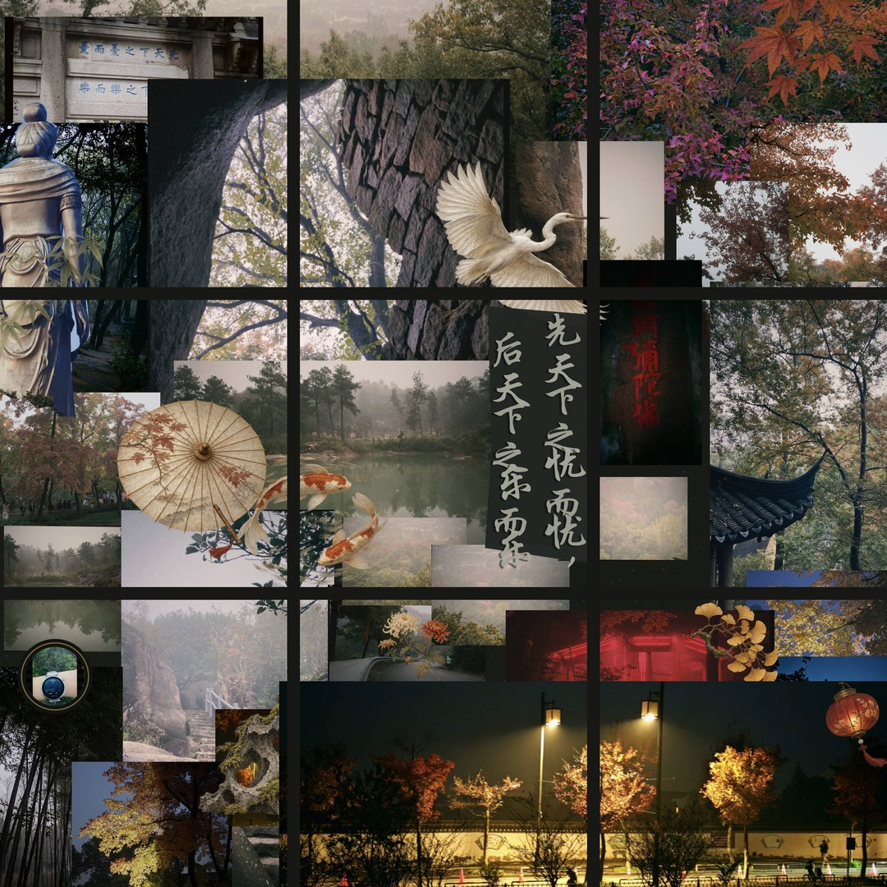

# 连幅照片九宫格

用实拍照片、透明贴纸和可选题字制作跨格连续的朋友圈九宫格。先在一张方形母版上排好全幅，再裁出九张连续的方图。

将这个仓库下载到 Codex 的技能目录 `~/.codex/skills/continuous-photo-grid`，然后用 `$continuous-photo-grid` 调用。例如：

> 用 $continuous-photo-grid 把这个文件夹里的照片做成九宫格，让同一张夜景横跨底排。

已有方形母版时，也可单独运行导出脚本。母版边长须可被 3 整除。

```bash
python3 -m pip install Pillow
python3 scripts/export_grid.py master.png outputs --name '秋日连幅'
```

脚本输出无缝整图、带缝预览和包含九张单图的 ZIP。发朋友圈时按 01 到 09 的顺序选图。

## 实拍处理案例

[天平山秋日连幅](examples/tianping-mountain/) 展示石洞、雾湖、夜灯原片如何跨格，并附有成品母版和可直接试跑的导出命令。

[](examples/tianping-mountain/)

## 技能文件

- [SKILL.md](SKILL.md) 是工作入口，说明使用范围和整体流程。
- [构图与跨格](references/composition.md) 说明怎样从参考图识别连续关系，并安排实拍主景和次景。
- [透明贴纸与题字](references/stickers-and-lettering.md) 说明素材生成、重用、透明边缘和竖排书法。
- [修订、导出与验收](references/revision-and-delivery.md) 给出删图、置顶和检查裁切的做法。
