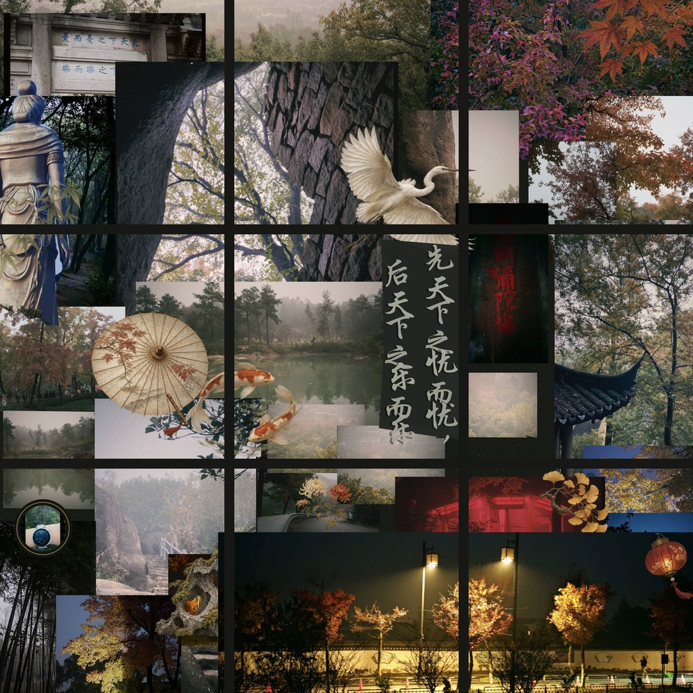

# 处理案例 · 天平山秋日连幅

把石洞、雾湖和夜灯做成一张跨格连续的照片拼贴，配上白鹭、锦鲤、油纸伞等透明贴纸与灰白行草。这是最终的无边框版本。



## 原片怎么处理

| 代表性原片 | 构图处理 | 成品位置 |
| --- | --- | --- |
| [石洞](source-cave.jpg) | 裁掉胶片边，把洞口和斜向石壁放大。白鹭贴在边缘，保留洞口透光的形状。 | 左上至中上，再向下接到中排 |
| [雾湖](source-lake.jpg) | 保留横向湖岸和倒影，裁成跨格横景。油纸伞压住左侧接缝，锦鲤放在水面与近景交界。 | 中排左侧和中央 |
| [夜灯](source-night.jpg) | 扩成底部横景并置于前景，让两盏路灯的灯头和灯杆完整露出。 | 底排中央和右侧 |

题字用两列灰白行草，从右向左读「先天下之忧而忧，后天下之乐而乐」。把整幅缩小后，检查瓦檐、湖岸和灯下的树影能否跨缝接上，同时检查贴纸有没有盖住主景。上表展示三张代表性输入，母版还包含其他天平山原片。

## 试跑九宫格导出

仓库里的 [无缝母版](master.jpg) 是 1620×1620 的公开示例。从仓库根目录运行：

```bash
python3 -m pip install Pillow
python3 scripts/export_grid.py examples/tianping-mountain/master.jpg outputs --name '天平山示例'
```

会得到一张带缝预览、一张无缝整图，以及九张 540×540 的单图 ZIP。选图顺序是 01 → 09。
